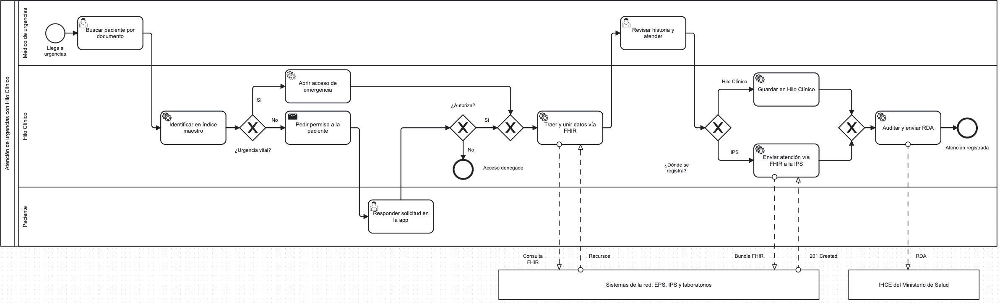

# Hilo Clínico

Capa de interoperabilidad clínica que une, en una sola historia, los datos de una persona que hoy están repartidos entre su **EPS**, las **IPS** donde la han atendido y los **laboratorios**. Hilo Clínico **no reemplaza** esos sistemas. Los consulta vía **HL7 FHIR R4**, solo con el permiso de la paciente, y deja todo registrado en la auditoría.

> Este repositorio reconstruye como software el prototipo del MVP (`boceto.html`), que es la fuente de verdad funcional. Todos los datos son ficticios.

---

## Proceso TO-BE (BPMN)



Fuente editable: [`assets/hilo-clinico-to-be (1).bpmn`](<assets/hilo-clinico-to-be (1).bpmn>)

**Carriles**

| Carril | Rol |
|---|---|
| Médico de urgencias | Busca a la paciente, revisa su historia y la atiende |
| Hilo Clínico | Índice maestro, consentimiento, adaptadores FHIR, auditoría y RDA |
| Paciente | Autoriza o rechaza el acceso desde su app |
| Sistemas de la red (pool externo) | EPS, IPS y laboratorios que responden las consultas FHIR |
| IHCE del Ministerio de Salud (pool externo) | Recibe el Resumen Digital de Atención (RDA) |

**Recorrido**

1. **Llega a urgencias** (inicio).
2. **Buscar paciente por documento** *(tarea de usuario, médico)*. El médico escribe el documento en el visor y marca si es una urgencia vital.
3. **Identificar en índice maestro** *(servicio)*. El MPI reconoce a la misma persona en la EPS, la IPS y el laboratorio, aunque cada uno la guarde con otro formato.
4. **¿Urgencia vital?** *(compuerta XOR)*
   - **Sí** → **Abrir acceso de emergencia**: acceso sin autorización previa, limitado a 24 horas. La paciente recibe el aviso y el acceso queda auditado.
   - **No** → **Pedir permiso a la paciente** *(envío de mensaje)*. El gestor de consentimiento envía la solicitud a la app.
5. **Responder solicitud en la app** *(tarea de usuario, paciente)*. Decide qué categorías puede ver el médico.
6. **¿Autoriza?** *(XOR)*
   - **No** → **Acceso denegado** (fin). No se consulta ninguna fuente. El médico atiende con lo que la paciente le cuente y el rechazo queda en la auditoría.
   - **Sí** → se une con la rama de emergencia.
7. **Traer y unir datos vía FHIR** *(servicio)*. Los adaptadores consultan cada fuente (*Consulta FHIR → Recursos*) y traducen su formato a recursos FHIR.
8. **Revisar historia y atender** *(tarea de usuario, médico)*. Alergias, consultas, fórmulas, autorizaciones y exámenes aparecen en una sola línea de tiempo.
9. **¿Dónde se registra?** *(XOR, según lo que elija el médico o la configuración de la IPS)*
   - **Hilo Clínico** → **Guardar en Hilo Clínico**.
   - **IPS** → **Enviar atención vía FHIR a la IPS**: `POST` de un `Bundle` de tipo `transaction` al endpoint de la IPS (*Bundle FHIR → 201 Created*). Hilo Clínico guarda solo la referencia.
10. **Auditar y enviar RDA** *(servicio)*. Registra el acceso y envía el Resumen Digital de Atención al IHCE.
11. **Atención registrada** (fin).

---

## Lógica del sistema

### 1. Fuentes de datos (cada una en su formato nativo)

| Fuente | Tipo | Formato | Qué aporta | Recursos FHIR que produce |
|---|---|---|---|---|
| EPS Andina | EPS | Tabla plana (`num_doc`, `fec_nac` `AAAAMMDD`, `regimen`, `estado`) | Afiliación y autorizaciones | `Coverage`, `ServiceRequest` |
| Centro Médico Chapinero | IPS | JSON propio (`id` `P-00417`, documento `CC-1.032.456.789`, fechas `DD/MM/AAAA`) | Alergias, atenciones con CIE-10, fórmulas | `AllergyIntolerance`, `Encounter`, `Condition`, `MedicationRequest` |
| Laboratorio Bioandes | Laboratorio | CSV con `;` (`orden;doc_paciente;fecha_hora;analito;valor;unidad;ref_min;ref_max`) | Hemograma y proteína C reactiva | `Observation` (categoría `laboratory`, con interpretación según el rango de referencia) |

Cada fuente tiene un **adaptador** que lee su formato y devuelve recursos FHIR R4 que apuntan a `Patient/{id maestro}`.

### 2. Índice maestro de pacientes (MPI)

- Normaliza el documento dejando solo los dígitos (`CC-1.032.456.789` → `1032456789`).
- Si el documento tiene menos de 6 dígitos devuelve el error `corto`. Si ninguna fuente lo reconoce devuelve `no-existe`.
- Busca el documento en las tres fuentes y devuelve:
  - **paciente maestro**: `id = hc-{documento}`, nombre normalizado, fecha de nacimiento en ISO y sexo. Marca `complete` cuando las tres fuentes la reconocen.
  - **identidades**: el ID local con que cada fuente conoce a la persona (`CC 1032456789` en la EPS, `P-00417` en la IPS, la orden `LB-2291` en el laboratorio).

### 3. Gestor de consentimiento

La paciente autoriza por **categorías**. Cada categoría habilita ciertos tipos de recurso:

| Categoría | Tipos de recurso habilitados |
|---|---|
| Alergias y medicamentos | `AllergyIntolerance`, `MedicationRequest` |
| Exámenes de laboratorio | `Observation` |
| Consultas anteriores | `Encounter`, `Condition` |
| Afiliación y autorizaciones de tu EPS | `Coverage`, `ServiceRequest` |

- Cada decisión genera un recurso `Consent` (`provision.type = permit`) con vigencia de **24 horas**, a favor del médico y de su IPS.
- **Modo paciente**: ella elige qué categorías comparte.
- **Modo emergencia**: se abren todas las categorías sin autorización previa y la paciente recibe el aviso.
- **Revocación**: desde la app la paciente puede revocar el acceso en cualquier momento. Desde ese momento la historia deja de estar visible para el médico.
- **Regla central**: un tipo de recurso solo se consulta si hay un `Consent` activo que lo incluye. Si no, la petición responde **403** y **no se consulta la fuente**.

### 4. Consulta y unión vía FHIR

Por cada fuente y cada tipo de recurso se arma una petición (`GET /Observation?patient=…&category=laboratory`, `GET /Coverage?beneficiary=…`, etc.) y se registra en el log de **Peticiones FHIR** con su estado (200 o 403) y el número de recursos devueltos.

Con los recursos permitidos se construye la **línea de tiempo**, ordenada de lo más reciente a lo más antiguo, con fecha relativa ("hace 8 días"):

- Exámenes de laboratorio, con la bandera de cada analito y marca de *reciente* si tienen 30 días o menos.
- Consultas (`Encounter` con su `Condition`, CIE-10 y profesional).
- Fórmulas médicas (`MedicationRequest`).
- Autorizaciones de la EPS (`ServiceRequest` aprobada y aún sin realizar).

Aparte, en un lugar destacado, se muestran las **alergias** (con criticidad) y la **cobertura** de la EPS.

### 5. Registro de la atención

- El médico escribe la nota de la atención (por ejemplo: *"No se repiten hemograma ni PCR"*, porque ya están en la historia).
- **RDA**: un `Bundle` de tipo `document` con `Composition`, `Encounter` (clase `EMER`), la alergia relevante y `ClinicalImpression` con la nota.
- **Envío a la IPS**: un `Bundle` de tipo `transaction` con `Encounter`, `ClinicalImpression` y `Provenance` (origen: Hilo Clínico) que se envía por `POST` al endpoint FHIR de la IPS. Se espera `201 Created`.

### 6. Auditoría

Cada paso deja un `AuditEvent` con quién hizo qué, sobre qué fuente, el resultado (`ok`, `warn` o `deny`) y la hora. Esto incluye la búsqueda en el MPI, la apertura de emergencia, la solicitud de permiso, la respuesta de la paciente, cada consulta a una fuente (o su bloqueo), el guardado o envío de la atención, el envío del RDA y la revocación.

### 7. Motor del proceso

El proceso es una **máquina de estados** que recorre el modelo BPMN nodo por nodo:

- Las **tareas de usuario** (`user`) se detienen y esperan una acción del médico o de la paciente.
- Las **tareas de servicio** (`service`, `send`) y las **compuertas** (`xor`) avanzan solas y ejecutan su efecto: MPI, consentimiento, FHIR, auditoría o RDA.
- Las compuertas eligen su salida a partir del contexto: si se marcó urgencia vital, si la paciente autorizó y qué destino eligió el médico.
- La simulación se puede **avanzar o retroceder paso a paso** (flechas ← →) y **reiniciar** en cualquier escenario.

---

## Escenarios de la simulación

Paciente de ejemplo: **Mariana Sofía López Castro**, CC 1.032.456.789. Llega a urgencias de la **Clínica del Pacífico (Cali)** con dolor abdominal y fiebre. La atiende el **Dr. Mateo Vargas**.

| Escenario | Qué pasa |
|---|---|
| **Con autorización** | Mariana autoriza desde su app. Se consultan solo las categorías que eligió. |
| **Urgencia vital** | Mariana no puede responder. Se abre el acceso de emergencia por 24 h y se audita. |
| **Mariana no autoriza** | Sin permiso no se consulta nada. El proceso termina en *Acceso denegado*. |

Lo que gana la atención: el médico ve a tiempo la **alergia grave a la penicilina** y los **exámenes del 7 de noviembre**, así que no repite el hemograma ni la PCR.

---

## Vistas del prototipo

- **Simulación**: el visor clínico del médico y la app de la paciente lado a lado, más el panel *La capa por dentro* con sus pestañas: Peticiones FHIR, Auditoría, Recurso FHIR y Red de IPS.
- **Proceso BPMN**: el diagrama TO-BE, con la ejecución resaltada paso a paso y una ayuda en cada nodo.
- **Impacto en salud**: el proceso de hoy frente al proceso con Hilo Clínico, por qué esperamos impacto en salud y el aporte a los Objetivos de Desarrollo Sostenible.

---

## Stack propuesto

### Frontend (MVP)

| Capa | Tecnología | Por qué |
|---|---|---|
| Lenguaje | **TypeScript** | Tipos estrictos para el dominio y los recursos FHIR |
| Framework UI | **React 18** | Es lo que usa el boceto, así se reproduce fiel |
| Build / dev server | **Vite** | Arranque rápido y build estática lista para desplegar |
| Animaciones | **Framer Motion** | El token que recorre el BPMN y las transiciones de pantalla del boceto |
| Iconos | **lucide-react** | Los mismos iconos del boceto |
| Tipos FHIR | **@types/fhir** (R4) | Valida al compilar que `Consent`, `AuditEvent`, `Bundle`, etc. sean FHIR válido |
| Estilos | **CSS con variables** (`tokens.css`) | Se reutilizan los tokens del boceto (`--ink`, `--coral`, `--sky`…) sin depender de un framework |
| Fuentes | **@fontsource** (Urbanist, Fraunces) | Reemplaza las fuentes incrustadas en base64 del boceto |
| Diagrama BPMN | **SVG propio** a partir de `process/model.ts` | El modelo del proceso es una sola fuente de verdad: lo usan el motor y el dibujo |

### Calidad

| Uso | Herramienta |
|---|---|
| Tests unitarios (dominio y motor del proceso) | **Vitest** |
| Tests de componentes | **React Testing Library** |
| Tests end-to-end (los 3 escenarios) | **Playwright** |
| Lint y formato | **ESLint** + **Prettier** |
| CI | **GitHub Actions** (lint, tests y build en cada PR) |

### Backend (fase posterior, opcional)

| Componente | Tecnología |
|---|---|
| Fuentes simuladas de la red (EPS, IPS, laboratorio) | **HAPI FHIR** en **Docker** |
| API de Hilo Clínico (MPI, consentimiento, adaptadores, RDA) | **Node.js + Fastify** (TypeScript) |
| Persistencia (consentimientos, auditoría, índice maestro) | **PostgreSQL** |
| Autorización | **SMART on FHIR** (OAuth 2.0) |

### Arquitectura del código

```
src/
  domain/        lógica pura, sin React (100% testeable)
    fhir/          builders: Consent, AuditEvent, RDA, Bundle transaction
    sources/       datos ficticios en su formato nativo (tabla, JSON, CSV)
    adapters/      cada fuente → recursos FHIR
    mpi.ts         índice maestro de pacientes
    consent.ts     reglas de permiso por categoría
    timeline.ts    línea de tiempo clínica
  process/
    model.ts       nodos, carriles y flujos del BPMN
    engine.ts      máquina de estados (avanzar, retroceder, escenarios)
  ui/
    simulation/    visor del médico, app de la paciente, "La capa por dentro"
    bpmn/          diagrama SVG con el token animado
    impact/        vista de impacto en salud y ODS
  styles/
    tokens.css
tests/           unitarios, componentes y e2e
```

La regla es que **el dominio no depende de la UI**. MPI, consentimiento, adaptadores y motor son funciones puras que se prueban solas. Así, en la fase de backend se pueden mover al servidor sin reescribirlas.

---

## Estructura del repositorio

```
assets/      diagrama BPMN (PNG y .bpmn editable)
boceto.html  prototipo de referencia (fuente de verdad funcional)
src/         código de la reconstrucción
```
